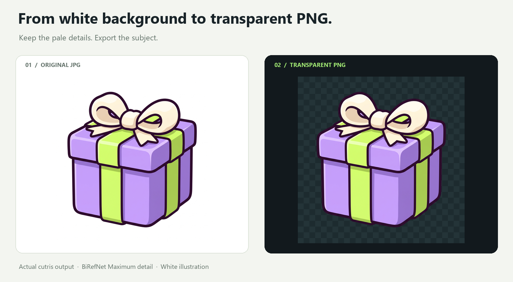
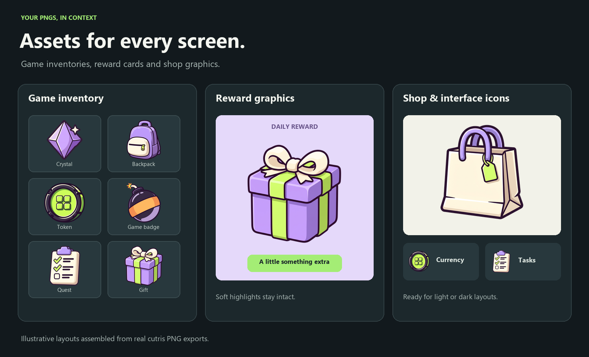
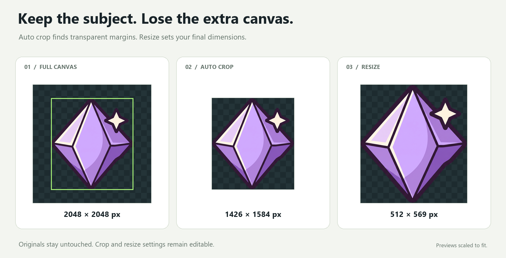

<p align="center">
  
</p>

<p align="center">
  <strong>Offline AI background removal for Windows.</strong><br>
  Process a batch. Refine the details. Export transparent PNGs.
</p>

<p align="center">
  
  
  <a href="LICENSE"></a>
</p>

<p align="center">
  <a href="../../releases/latest"><strong>Download for Windows</strong></a> &nbsp;·&nbsp;
  <a href="docs/usage.md">Editor guide</a> &nbsp;·&nbsp;
  <a href="docs/windows.md">Setup &amp; troubleshooting</a>
</p>



<p align="center"><sub>Actual cutris output. Checkerboard shows transparency.</sub></p>

## From a batch to a finished cutout

- **Batch work:** queue up to 50 images, reorder, pause, resume, and reopen saved batches.
- **Local AI:** BiRefNet detail and lite models run on your CPU. No account, subscription, or image uploads.
- **Precise repairs:** Erase, Restore, Magic wand, undo, and redo. Inspect against light, dark, or custom preview colors.
- **Crop and resize:** auto crop removes empty transparent margins; manual crop and pixel sizing prepare the final canvas.
- **Ready to use:** transparent PNGs, individually or in an ordered ZIP. Originals stay untouched.

## Put your cutouts to work



<p align="center"><sub>Illustrative layouts assembled from real PNG exports.</sub></p>



<p align="center"><sub>Auto crop removes unused transparent margins. Resize sets the output dimensions.</sub></p>

## Get started

1. Download **`cutris-<version>-windows-x64-setup.exe`** from the [latest release](../../releases/latest) and install cutris.
2. Download either AI model during setup or when the app asks. Both together need about **1.2 GB**; processing works offline afterward.
3. Drop in your images, remove backgrounds, review the cutouts, and export. Save any touch-ups before downloading.

Windows 10/11 x64, CPU processing, and WebView2 are required. Setup installs WebView2 if missing. **16 GB RAM** is recommended for Maximum detail and large images. A portable ZIP is also available in each release.

Input: PNG, JPG, WebP, BMP, and TIFF; up to 30 MB and 24 megapixels per image. Fine hair, glass, shadows, and pale edges can need manual repair. [Formats, limits, and editing controls →](docs/usage.md)

## Development

Use 64-bit Python 3.11–3.13 on Windows. Run `Setup.cmd`, then `Start.cmd` to open the desktop app. For tests:

```powershell
.\.venv\Scripts\python.exe -m pip install -r requirements-dev.txt
.\.venv\Scripts\python.exe -m pytest -q
```

`Start-browser.cmd` opens the local interface in your browser. The service binds to `127.0.0.1` and is intended for one local user.

| Learn more | |
| --- | --- |
| [Publish a release](docs/releasing.md) | Run GitHub Actions with a version and semicolon-separated release notes. |
| [Privacy & storage](docs/privacy.md) | Where images, models, and saved batches live. |
| [Branding](docs/branding.md) | Change the app name and release metadata. |
| [Contributing](CONTRIBUTING.md) | Report issues and propose changes. |

## Open source

cutris is [MIT licensed](LICENSE). Built with [BiRefNet](https://github.com/ZhengPeng7/BiRefNet), ONNX Runtime, and pywebview. Models and bundled dependencies retain their own licenses; see [third-party notices](THIRD_PARTY_NOTICES.md).
